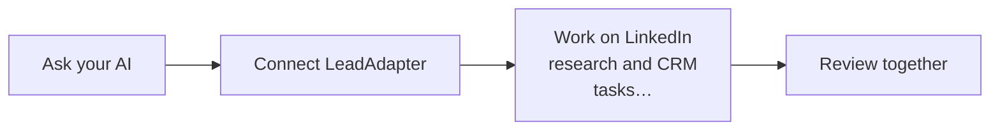

# Work on LinkedIn research and CRM tasks with your assistant

**LinkedIn + your AI assistant · powered by LeadAdapter**

You want to ask your coding assistant for LinkedIn research, engagement analysis and reviewed CRM work using the tools your LeadAdapter account actually exposes.

**Made for:** People using a coding assistant for sales work

Real tasks need a LeadAdapter account. Connect LinkedIn too when your task needs fresh LinkedIn activity.

## Ask your AI to set this up

Paste this into a coding assistant that can open project files and run commands, such as Codex, Claude Code or Grok Build. You do not need to understand the code first.

```text
Help me use this project: https://github.com/jannikco/linkedin-mcp

I'm not a programmer. My goal is: Work on LinkedIn research and CRM tasks with your
assistant.

Read the project instructions and set it up in a new folder without overwriting my work.
Guide me through LeadAdapter and its private key setup; never ask me to paste secrets into
this chat. Run a documented sample-data demo if available, then help me get a first small
result from my connected app. Explain the result in plain English. Ask before changing
records, sending messages or publishing anything.
```

## Three useful things to ask for

```text
Connect to my authorized LeadAdapter tools and explain the available actions in plain
English.
```

```text
Help me choose one useful research task from the tools actually returned. Ask before any
action that changes data or contacts another person.
```

```text
Turn the completed research we review into a concise customer brief and a proposed next
step for the sales team.
```

## Your path to a real result



1. [Open LeadAdapter setup](https://leadadapter.com/github/start?integration=linkedin-mcp&flow=agent-lead-review&utm_source=github&utm_campaign=github-linkedin-mcp&utm_content=people-first-readme) and sign in or create your account.
2. Connect a LinkedIn profile if your chosen task needs fresh LinkedIn activity.
3. Create the product API key through the official setup, add it privately to your AI project's environment, and ask your AI to try a small read.

**What to expect:** You need one LeadAdapter API key and the workspace access required by the task. LinkedIn operations also depend on the connected profile, consent and available tools. Work that is queued stays pending until a real result is returned.

Add your LeadAdapter key privately in your project settings. Keep keys out of chat and public repositories.

## Keep going

- [Explore the LinkedIn API](https://github.com/jannikco/linkedin-api)
- [Build with the JavaScript / TypeScript client](https://github.com/jannikco/linkedin-typescript-sdk)
- [Build with the Python client](https://github.com/jannikco/linkedin-python-sdk)

<details>
<summary>Technical reference: installation commands, exact capabilities and troubleshooting</summary>

<!-- people-first:technical:start -->
# LinkedIn MCP for Claude, Codex and AI agents

## Review a lead shortlist from your AI assistant

Discover an authorized read tool, then produce a reviewable lead brief.

### Try the task with synthetic data

No product key is needed for this demo. Requires Node.js 22+.

```sh
npm ci --ignore-scripts
npm run demo
# Optional: save a private report to a new file.
npm run demo -- --output ./synthetic-report.json
```

Output: a task-specific JSON review report selecting 1 of 2 invented records. It includes the completed fixture receipt and a request trace; no provider request or write occurs.

The synthetic records use normalized review fields. Review and map your actual provider schema before applying the same selection to live data.

### Use your authorized account

[Activate this task](https://leadadapter.com/github/start?integration=linkedin-mcp&flow=agent-lead-review&utm_source=github&utm_campaign=github-linkedin-mcp&utm_content=task-demo), then set **LEADADAPTER_API_KEY** in your process environment. Select an authorized connected LinkedIn profile; existing scopes, caps and review requirements apply.

```sh
npm run preflight
```

Preflight checks access/discovery only; it does not count as a completed provider task. For an explicitly reviewed read, use the returned live schema and the exact operation/tool, arguments and stable idempotency key:

```sh
npm run verify:read -- --tool '<actual discovered read-only tool>' --arguments '<reviewed argument JSON>' --idempotency-key '<stable request key>' --confirm-read-only
```

The verification command performs only the selected authorized read; it refuses writes and never selects a customer operation automatically. Only a completed receipt establishes a live read. Missing access, pending jobs and uncertain outcomes remain explicit blockers. Reports contain receipt digests rather than customer payloads. No prices, trials or account allowances are changed.


**Give your AI assistant access to your authorized LinkedIn workflows through LeadAdapter. One LeadAdapter API key.**

Research people, inspect engagement, enrich selected profiles and work with leads through the tools enabled in your workspace. This package bridges stdio MCP clients to LeadAdapter's hosted MCP endpoint; it discovers the server's actual tools and schemas at runtime.

[Get your LeadAdapter API key](https://leadadapter.com/github/start?integration=linkedin-mcp&utm_source=github&utm_campaign=github-linkedin-mcp) · [API documentation](https://leadadapter.com/docs/api-reference?lang=en) · [Integration directory](https://jannikco.github.io/pipmcp-connectors/integrations/linkedin/)

## Connect your agent

Requires Node.js 22+. Clone this repository and install its pinned dependencies:

```sh
git clone https://github.com/jannikco/linkedin-mcp.git
cd linkedin-mcp
npm ci --ignore-scripts
npm test
node example.mjs
```

Set LEADADAPTER_API_KEY in the environment used by your MCP client. Configure its stdio server command as node with the absolute argument /path/to/linkedin-mcp/lib/cli.mjs. Keep the API key in the client's protected environment, never in a committed JSON file. You may also connect a client that supports the hosted endpoint directly to https://leadadapter.com/mcp.

Only your LeadAdapter key is used. Available tools depend on the workspace's scopes, connected account, tier and policy. The bridge does not promise that every REST operation is an MCP tool.

## Ask for an outcome

“Research software founders matching our ICP. Show me a source-backed shortlist before adding anyone to CRM.”

“Find the people engaging with this post and help me review who belongs in our pipeline.”

The bundled .agents/skills and .claude/skills provide task instructions for Codex, Claude Code and Grok Build. See AGENTS.md, capabilities.json and llms.txt for discovery. These instructions use your existing agent session; no extra AI model API key is required.

## Remote discovery and receipts

```js
import {LeadAdapterMcpClient} from './lib/index.mjs';
const client = new LeadAdapterMcpClient({apiKey: process.env.LEADADAPTER_API_KEY});
try {
  const tools = await client.listTools();
  console.log(tools); // Inspect the actual remote schemas before selecting a tool.
} finally {
  await client.close();
}
```

The bridge preserves remote tool schemas and results, handles JSON/SSE sessions and paginated discovery, and never approves or retries uncertain mutations automatically. A queued job remains pending. Research is separate from approved CRM writes.

## Upgrade from 0.2

Version 0.3 replaces the historical local REST-backed tool subset with the actual remote MCP inventory. Discover tools again and update clients that depended on local names. Historical MIT code remains in Git history.

## Evidence and support

Package behavior is tested with synthetic remote MCP fixtures. Live authentication and LinkedIn execution require your authorized account and are not implied by passing fixture tests. Never include API keys or personal records in public issues. MIT applies to this bridge; LeadAdapter's hosted execution remains private.

<!-- people-first:technical:end -->

</details>
